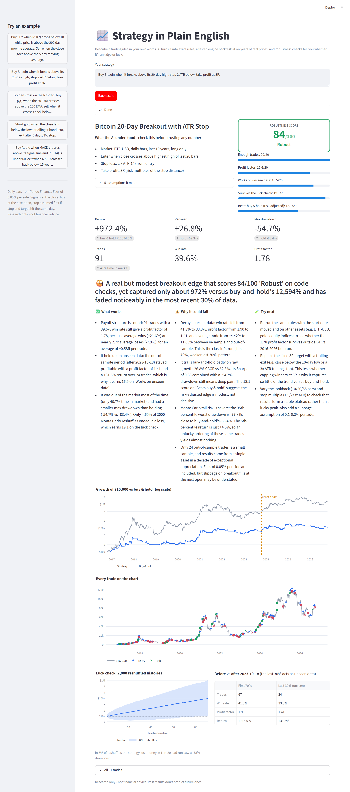

# Strategy in Plain English

**Describe a trading idea in your own words. About a minute later you know whether it's an edge or just luck.**

> *"Buy Bitcoin when it breaks above its 20-day high, stop 2 ATR below, take profit at 3R."*



Type that and the app:

1. **Understands it.** Claude turns your sentence into a strict rulebook and shows it back to you, along with every assumption it made (which market, how many years, which kind of moving average).
2. **Backtests it.** A tested engine replays 10+ years of real daily prices, trade by trade, with fees, next-day fills and realistic stop handling.
3. **Stress-tests it.** It reshuffles your trades 2,000 times (Monte Carlo), checks the last 30% of history the rules never "saw", and compares the result with simply buying and holding.
4. **Gives a verdict.** A robustness score from 0 to 100 (*Robust / Fragile / Doesn't hold up*), plus a plain-English explanation of what works, why it could fail, and what to test next.

## Real results (run on 2026-10-16)

| Strategy (typed in plain English) | Trades | Return | Buy & hold | Score |
|---|---|---|---|---|
| SPY: buy when RSI(2) < 10 above the 200 SMA, sell on close > 5 SMA, 2% stop | 95 | −1.8% | +319% | **49, Fragile** |
| Bitcoin: 20-day breakout, 2 ATR stop, 3R target | 91 | +973% | +12,674% | **88, Robust** |

The second one is the interesting case. The edge is real: it holds up on unseen data and survives the luck check, with a smaller drawdown than holding. But it still made far less money than just holding Bitcoin, and the verdict says so plainly. That kind of honesty is the point of the tool.

## What this demonstrates

- **Natural language → structured output.** Claude fills a strict, validated schema (`strategy_spec.py`, via the Anthropic SDK's `messages.parse` with Pydantic) instead of writing free-form code. Nothing the AI writes is ever executed.
- **AI where it helps, deterministic code where it matters.** Claude handles understanding and explaining. The numbers come from a plain Python engine with unit tests, so they're reproducible and can't be hallucinated.
- **Guardrails against AI hype.** The robustness score is plain arithmetic, not an AI opinion. Claude explains it but can't override it, and it may only cite numbers it was given.
- **Transparent assumptions.** Every guess the AI makes, and anything it couldn't model, is shown to the user before the results.
- **Quant robustness methods.** Out-of-sample testing, bootstrap Monte Carlo, risk-adjusted comparison with buy-and-hold, and a conservative fill model.
- **Tested engine.** `tests/test_backtest.py` checks entries, exits, stops, R-multiple targets, overnight gaps, shorts, fees and indicators against answers worked out by hand.

## How it works

```
"your idea in English"
        │
        ▼
 Claude ──► rulebook (strict JSON schema)  ──► shown to you + validated
                                                   │
             Yahoo Finance daily prices ──► backtest engine (backtest.py)
                                                   │
                     out-of-sample split + Monte Carlo + buy & hold (robustness.py)
                                                   │
                              robustness score (pure arithmetic)
                                                   │
 Claude ◄── the measured numbers only ──► plain-English verdict
```

| File | What it does |
|---|---|
| `strategy_spec.py` | The rulebook format Claude must fill in, plus validation and plain-English descriptions. |
| `ai.py` | The two Claude calls: English → rulebook, and numbers → verdict. |
| `data.py` | Downloads daily prices from Yahoo Finance. |
| `indicators.py` | SMA, EMA, RSI, ATR, MACD, Bollinger Bands, N-day highs/lows. |
| `backtest.py` | The bar-by-bar engine and performance metrics. |
| `robustness.py` | Out-of-sample test, Monte Carlo luck check, robustness score. |
| `run.py` | The whole pipeline, plus a terminal version. |
| `app_streamlit.py` | The web version with interactive charts. |
| `tests/` | Engine tests. |

**What the rulebook can express:** close/open/high/low/volume, SMA, EMA, RSI, ATR, MACD and its signal line, Bollinger Bands, and N-day highs/lows. Rules can compare these with `>`, `<`, *crosses above* or *crosses below*. A strategy can have several entry rules (all must be true) and several exit rules (any one triggers). It also supports percent or ATR stops, percent, ATR or R-multiple targets, and a time exit. Strategies are long or short, on any Yahoo Finance market (stocks, ETFs, crypto, forex, commodities, indices).

## Setup (one time)

You need Python 3.10 or newer.

```bash
git clone https://github.com/Dcryptoman/plain-english-backtester.git
cd plain-english-backtester
```

```bash
python -m venv .venv
```

Activate it. On Windows (PowerShell):

```bash
.\.venv\Scripts\Activate.ps1
```

On Mac/Linux it's `source .venv/bin/activate`. Then:

```bash
pip install -r requirements.txt
```

Copy `.env.example` to `.env` and put your Anthropic API key in it (get one at https://console.anthropic.com/ → API Keys). Keep `.env` private.

## Run it

Web version (recommended):

```bash
streamlit run app_streamlit.py
```

Open http://localhost:8501, type a strategy (or click an example in the sidebar), and press **Backtest it**.

Terminal version:

```bash
python run.py "Golden cross on QQQ: buy when the 50 EMA crosses above the 200 EMA, sell when it crosses back below"
```

Engine tests (no API key needed):

```bash
python -m pytest
```

## How the robustness score works

The score has five parts worth 20 points each. They're shown in the app, so you can see exactly where a strategy lost points.

| Part | Full marks when |
|---|---|
| Enough trades | 30 or more trades (fewer is mostly noise) |
| Profit factor | Gross wins ÷ gross losses is 2.0 or more |
| Works on unseen data | Profit factor in the last 30% of history is 1.5 or more |
| Survives the luck check | Few of the 2,000 Monte Carlo reshuffles lose money |
| Beats buy & hold (risk-adjusted) | Yearly return ÷ worst drawdown matches or beats buy & hold |

70 or more = **Robust**, 45–69 = **Fragile**, below 45 = **Doesn't hold up**.

## Honest limits

- Daily bars only, and one position at a time with no leverage or position sizing.
- Yahoo Finance data is free but not institutional-grade, and it adjusts for splits and dividends.
- Fees are a flat 0.05% per side. Very active strategies on illiquid markets will do worse in real life.
- A good score means "survived these tests", not "will make money". Markets change.
- **This is a research tool, not financial advice.** It never tells you to buy or sell anything.

## Cost

Each backtest makes two Claude calls (understand + verdict), roughly 2–4 cents on Claude Opus 5.5. Change `MODEL` in `ai.py` to use a cheaper model.
